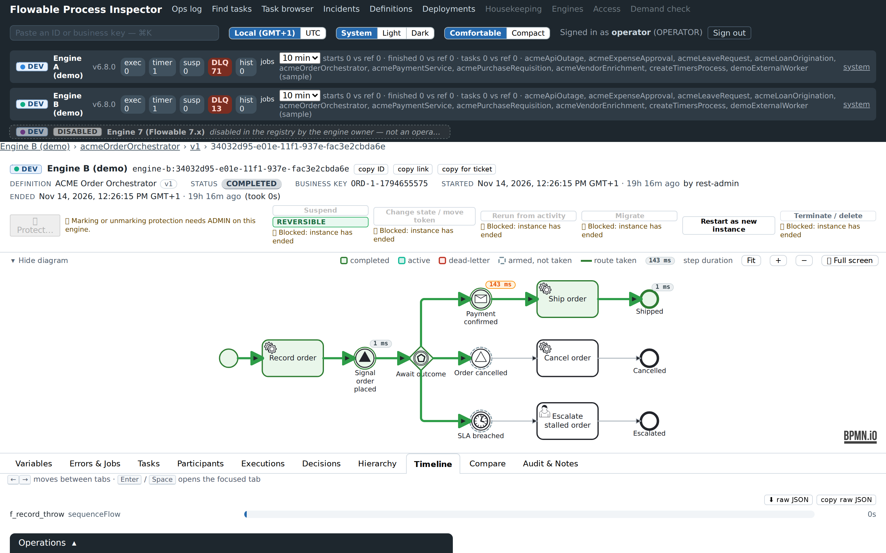
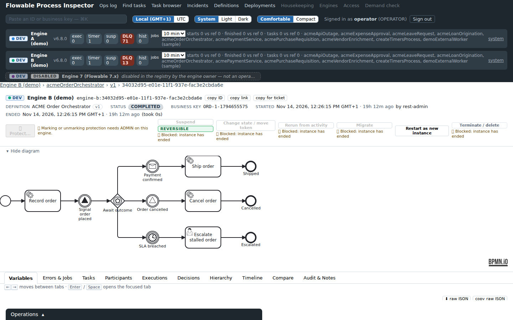
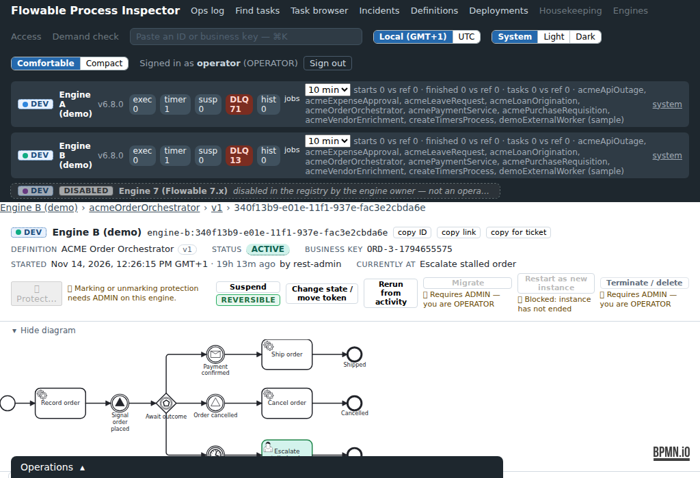
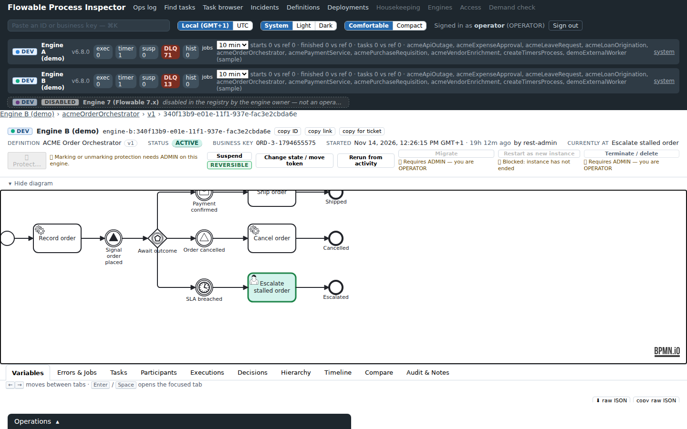
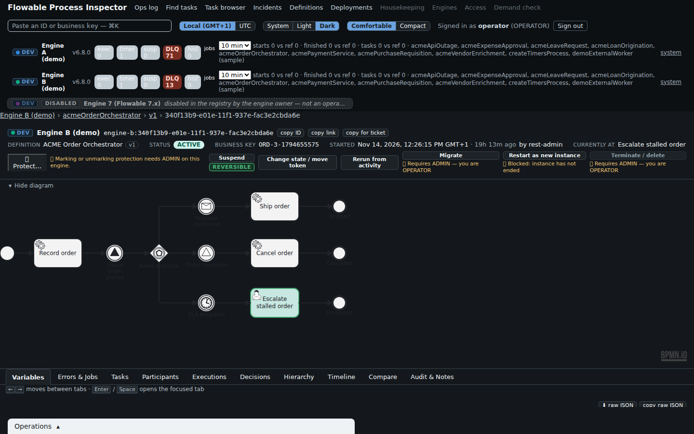
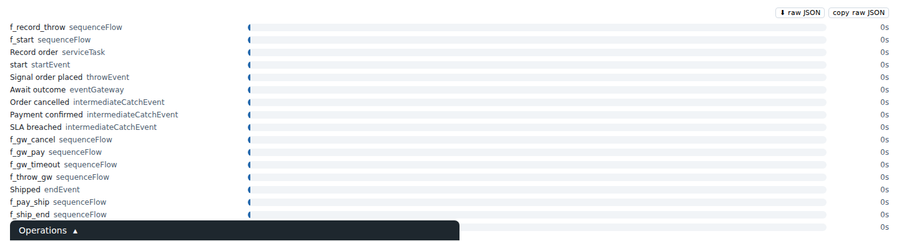
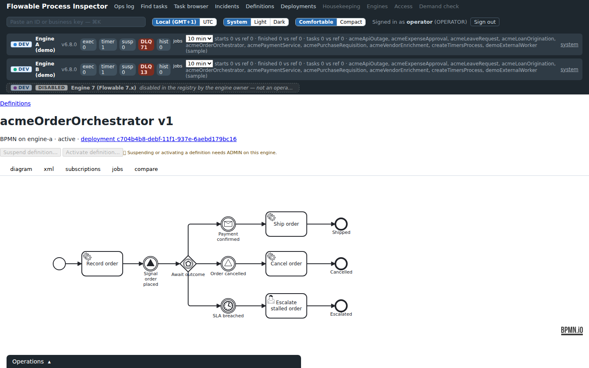
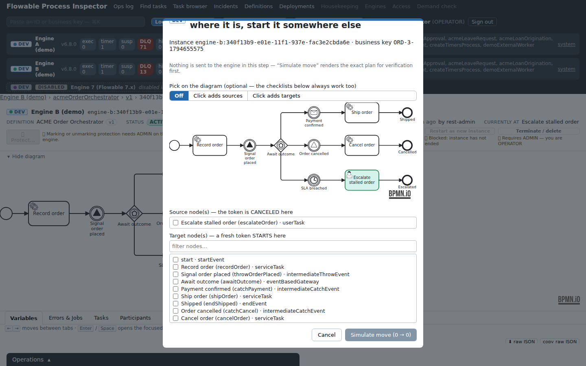

# Visualization & UX study — the process-model view (2026-11-15)

**Scope.** How the Process Inspector (PI) renders the BPMN model on the instance detail page
(`/inspect/:engineId/:instanceId`), the definition page and the change-state picker, compared
with the diagram work in the flap project's built-in inspector
(`flap/src/main/resources/templates/admin/process-detail.html`, `process-stats.html`).

**Method.** Code read of both implementations, plus pixel inspection of the real rendered PI
dev stack (Vite :5173, BFF :8085, engines A/B) with headless Chromium at 1024×700, 1440×900 and
1920×1080, signed in as `operator`. Layout numbers below are measured from the DOM, not
estimated. This is an expert review with measurements — no tester agents were run; the
existing `usability-run` harness drives the accessibility tree, which is why the pixel-level
findings here never surfaced in it.

**Not findings.** The `▯` glyphs next to "Protect…" and the RBAC hints in the screenshots are a
missing emoji font in the headless browser on this box. The "Await outcome" label crossed by a
flow line is the seed BPMN's own diagram interchange.

---

## 1. Headline

The diagram answers "where is the token now" and "where is the dead-letter job". It does not
answer the three questions an operator asks next: **how did it get here, which way did it go,
and where did the time go.** The flap inspector answers all three on the model itself, and PI's
timeline endpoint already returns every datum needed to do the same — no new engine call.

Separately, the page layout gives the diagram a fixed 45 % of the viewport and leaves the tab
panel with whatever remains, which at 1440×900 is **24 px**.

*Mockup: the live page for a completed `acmeOrderOrchestrator` instance with flap-style markers
injected from PI's own `/timeline` payload. Compare with the current rendering in F1.*

---

## 2. Findings

Severity: **S1** blocks the task · **S2** slows or misleads · **S3** polish.

### F1 (S1) — A completed instance shows a bare model: the path taken is invisible

The model has three outcomes (Shipped / Cancelled / Escalated). The instance is COMPLETED and
the diagram carries zero markers (`markers: []` measured), so the operator cannot tell which
end event was reached without opening the Timeline tab and matching raw ids by eye. The same
holds for every active instance: only the current node is lit, not the route to it.

`InstanceDiagram` carries only `activeActivityIds` and `deadLetterActivityIds`
(`frontend/src/api/schema.d.ts`), and `DiagramCanvas.applyMarkers` has no completed or
taken-flow marker.

**The data is already there.** `GET /api/instances/{e}/{i}/timeline` for this instance returns
17 rows including the `sequenceFlow` rows `f_start, f_record_throw, f_throw_gw, f_gw_pay,
f_pay_ship, f_ship_end` and a `durationMs` per activity.

### F2 (S1) — The tab panel is crushed to 24 px at 1440×900

| Viewport | Diagram canvas | Tab panel visible | Tab content height |
|---|---|---|---|
| 1024×700 | 193 px (cropped) | 0 px — tab bar is off-screen | — |
| 1440×900 | 273–366 px | **24 px** | 385 px (Timeline) |
| 1920×1080 | 486 px | 121 px | — |

`.diagram-canvas { height: 45vh }` does not shrink; `.tab-body { flex: 1; overflow: auto }`
has an implicit `min-height: 0`, so it absorbs the whole deficit and becomes a 24 px inner
scroller. Variables, Errors & Jobs and Timeline are effectively invisible on a laptop unless
the operator finds "Hide diagram" — which then removes the model. It is an either/or between
the two halves of the page. At 1024 px the fixed Operations drawer also covers the bottom of
the diagram.

Contributing: the global engine strip plus vitals plus action row consume 400–490 px before
the diagram starts; a three-node model still gets the full 45vh of mostly white canvas
(screenshot `failed.png`).

### F3 (S2) — Not centred, start event clipped, no zoom controls

`canvas.zoom('fit-viewport')` is called without the `'auto'` centre argument, so the model is
pinned to the top-left and the start event is cut by the left edge (visible in F1). There is no
Fit / zoom-in / zoom-out / full-screen control and no hint that wheel-zoom and drag-pan exist.
The flap inspector ships Fit / + / − on every diagram.

### F4 (S2) — Selecting a visible node scrolls it and clips its neighbours

Clicking "Escalate stalled order" — already fully visible — triggers
`canvas.scrollToElement`, which shifts the model up and cuts off the "Ship order" row. The
click also draws a heavy black focus ring around the entire canvas. Scroll should happen only
when the element is outside the viewport (bpmn-js `scrollToElement` accepts padding; a
visibility check before the call is enough).

### F5 (S2) — Dark theme: labels and flows disappear

Event and gateway labels ("Payment confirmed", "Await outcome", "Shipped" …) and all sequence
flows render dark-on-dark; task shapes stay bright white slabs. bpmn-js takes its colours from
inline styles, so the theme needs explicit `.djs-visual` overrides or the viewer's
`bpmnRenderer: { defaultFillColor, defaultStrokeColor, defaultLabelColor }` options wired to
the theme tokens. (The engine-strip count chips have the same contrast problem in dark mode.)

### F6 (S2) — No legend

Green fill = token, red fill + ⚠ = dead-letter, blue outline = selected, ▲/△ = sibling diff,
`+`/`~` = version diff, S/T = picker, ✖/!/↦ = migration findings. Each has a hover `title` and
an `aria-label`, but nothing on screen explains the vocabulary. The flap inspector puts a
one-line legend in the diagram header.

### F7 (S2) — Timeline tab: sub-second durations all read "0s", flows listed as raw ids

Every row shows `0s`, including the three catch events that took 141–143 ms — exactly the
steps one compares. Nine of seventeen rows are `sequenceFlow` entries labelled with raw ids
(`f_gw_timeout`), which is noise in a list and signal on the diagram. All bars are the same
sliver, so the tab does not show where time went. The flap inspector hit the identical
problem and fixed it with a ms-precision formatter (`<1 ms`, `143 ms`, `1.4 s`, `2 m 5 s`) and
a share-of-instance bar.

### F8 (S3) — Definition page

Header text is flush against the left edge with default link/heading styling, unlike the rest
of the app. The diagram is purely static: no instance counts, no dead-letter counts, no
timing per node — the page a model owner would open to ask "where does this process hurt".

### F9 (S3) — Change-state picker

The picker diagram works and is the right idea. It would benefit most from F1: seeing the
route already taken is the main input to choosing a safe target node. The modal title is
clipped at the top at 900 px height.

---

## 3. What the flap inspector does that PI should take over

| # | flap feature | Where in flap | PI status | Cost in PI |
|---|---|---|---|---|
| A | **Route taken**: traversed sequence flows stroked green, untaken stay thin grey | `process-detail.html` `paintTakenFlows` | missing | Frontend only — `sequenceFlow` rows already in `/timeline` |
| B | **×N loop badge** on a flow walked more than once | same | missing | Frontend only — count rows per flow id |
| C | **Completed-node marker** | `paint()` `flap-done` | missing | Frontend only |
| D | **Per-node duration badge**, slowest node highlighted, sub-ms nodes unbadged | `paintDurations` | missing | Frontend only — `durationMs` already in `/timeline` |
| E | **ms-precision duration format** shared by diagram and table | `fmtDuration` | Timeline shows `0s` | One formatter in `lib/format` |
| F | **Share-of-instance bar** per activity row | Activity history table | bars exist, not proportional | Frontend only |
| G | **Legend + Fit / + / −** in the diagram header | card header | missing | Frontend only |
| H | **Markers repainted in place** (remove/add markers; XML imported once) | `paint()` | PI re-runs `importXML` on every marker change and restores the viewbox | Refactor of one effect; removes the flicker and the viewbox-restore workaround |
| I | **Active-token pulse** | `tokenPulse` keyframes | static fill | CSS; must honour `prefers-reduced-motion` |
| J | **Aggregate heat map on the definition**: avg duration + hit rate per node, coloured by share of total time; outcome funnel by end event; p50/p95 table | `process-stats.html` | missing | Needs a new BFF aggregation over a bounded sample of historic activity instances — a real feature, not a restyle |

**Do not take over:** flap hides the bpmn.io watermark (`.bjs-powered-by { display:none }`).
PI's R-GOV-05 forbids that and the build check enforces it. flap also encodes state by hue
alone; PI's rule is stroke style + glyph, never hue alone, so the new markers need a
non-colour channel (see §4).

One refinement beyond flap, visible in the mockup: an event-based gateway arms all three
catch events, so all three have history rows. Marking them all "completed" would be wrong.
A node with a history row but no taken outgoing flow should read **"armed, not taken"**
(dashed outline), not completed.

---

## 4. Recommendations, in order

**R1 — Fix the layout (F2).** Smallest change with the largest effect. Give the tab panel a
floor (`.tab-body { min-height: 40vh }` or let `.inspect` scroll as one page) and size the
canvas to the model: `height: clamp(180px, <model bbox height + padding>, 45vh)`. Make the
split draggable later if wanted; a floor is enough to stop the crush.

**R2 — Route, completed, armed, durations on the instance diagram (F1; A–D).** Feed the
canvas from the existing timeline query. Encoding that respects "never hue alone":

- taken flow: heavier stroke (3 px vs 1.5 px) — width carries it, colour reinforces;
- completed node: tinted fill plus a ✓ corner glyph;
- armed-not-taken: dashed outline;
- duration: text badge; slowest gets a "slowest" label, not only an orange tint;
- every badge gets the `role="img"` + `aria-label` twin the existing overlays use.

Honesty rule to carry over from the status doctrine: if `timeline.truncated` is true, the
route is partial — show the truncation badge on the diagram rather than a route that silently
stops.

**R3 — Diagram toolbar (F3, F6; G).** Legend, Fit, +, −, full screen. Centre on import
(`zoom('fit-viewport', 'auto')`).

**R4 — Selection scroll (F4)** only when the element is outside the viewbox.

**R5 — Duration format + proportional bars in the Timeline tab (F7; E, F).** Hide
`sequenceFlow` rows behind a toggle once the diagram shows them.

**R6 — Dark-theme diagram colours (F5).**

**R7 — Repaint markers without re-import (H).** Enables the pulse (I) and live updates
without flicker.

**R8 — Definition heat map and outcome funnel (F8; J).** Worth its own design note: sample
bound, count-only doctrine, capability gating per engine version, and whether it belongs to
the definition page or the incident view.

R1–R6 are frontend-only and need no API or spec-contract change beyond SPEC §4's description
of the diagram markers. R8 is the only item that adds engine load.

---

## 5. Evidence files

`done13.png` (F1) · `failed.png`, `active13-1024.png` (F2) · `active13-clicked.png` (F4) ·
`active13-dark.png` (F5) · `timeline-tab-content.png` (F7) · `definition.png` (F8) ·
`change-state.png` (F9) · `mock-after.png` (proposal).

Instances used: `engine-b:34032d95-e01e-11f1-937e-fac3e2cbda6e` (completed),
`engine-b:340f13b9-e01e-11f1-937e-fac3e2cbda6e` (active),
`engine-b:33fdfd6c-e01e-11f1-937e-fac3e2cbda6e` (failed).
